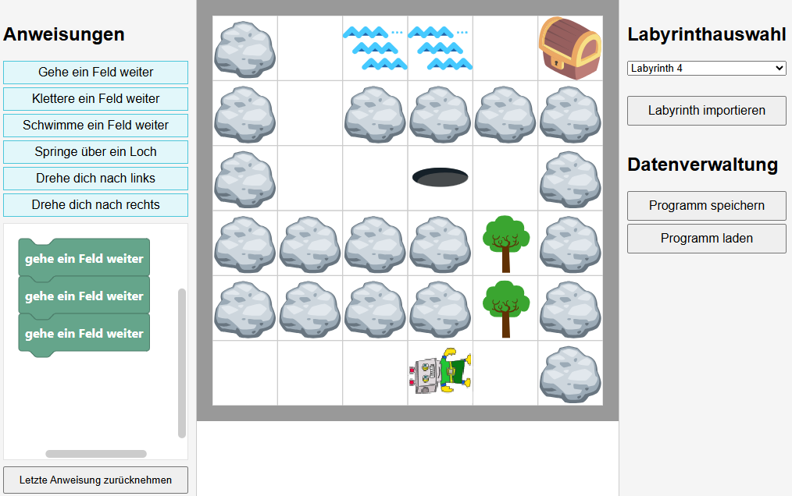

<a name="oben"></a>

<div align="center">

|[:skull:ISSUE](https://github.com/frankyhub/Robby-Blocky/issues?q=is%3Aissue)|[:speech_balloon: Forum /Discussion](https://github.com/frankyhub/Robby-Blocky/discussions)|[:grey_question:WiKi](https://github.com/frankyhub/Robby-Blocky/wiki)||
|--|--|--|--|
| | | | |
<a href="https://github.com/frankyhub/Robby-Blocky/issues">|<a href="https://github.com/frankyhub/Robby-Blocky/discussions">|<a href="https://github.com/frankyhub/Robby-Blocky/6eleases">||
|| <a href="https://github.com/frankyhub/Robby-Blocky/pulse" alt="Activity">| <a href="https://github.com/frankyhub/Robby-Blocky/graphs/traffic">  |<a href="https://github.com/frankyhub?tab=stars"> ||

</div>  

# 🤖 Story

Robby-Blocky ist ein interaktives Tool zum Probieren und Verstehen einfacher Anweisungen für einen Roboter – inspiriert von Turtle Graphics. 

## 🔍 Funktionen

- Interaktives Probieren der Blöcke und ihrer Wirkung
- Auswahl verschiedener Hindernisstouren mit steigender Schwierigkeit und Blockzahl
- Weitere Labyrinth ladbar - Entwickle eigene Labyrinthe mit dem [Robby-Editor](https://github.com/frankyhub/Robby-Edit))
- Speichern/Laden des Programmcodes als JSON

## 🖼️ Screenshot



## 🚀 Online ausprobieren

> Wird unterstützt durch **GitHub Pages**.

👉 [Hier klicken, um das Projekt direkt im Browser zu starten](https://frankyhub.github.io/Robby-Blocky/index.html)

## 📦 Installation (lokal)

Du kannst das Projekt lokal und ohne Internetzugang betreiben. Lade dazu alles über Code - Download ZIP herunter, entpacke das Archiv in einen Ordner und öffne `index.html` in einem Browser. Alternativ kannst du auch so vorgehen:

(Lade und installiere git for Windows https://gitforwindows.org/ )

```bash
git clone https://github.com/frankyhub/Robby-Blocky.git
cd Robby-Blocky
# Dann: index.html im Browser öffnen
```

## Grafikquellen
Vectors and icons by <a href="https://www.svgrepo.com" target="_blank">SVG Repo</a>
- robot.svg - COLLECTION: Universe 17, LICENSE: CC0 License, UPLOADER: SVG Repo
- rock.svg - COLLECTION: Twemoji Emojis, LICENSE: MIT License, AUTHOR: Twitter
- hole.svg - COLLECTION: Fxemoji Emojis, LICENSE: Apache License, AUTHOR: Mozilla
- treasure.svg - COLLECTION: Lechazo Conf Flat Vectors, LICENSE: CC Attribution License, AUTHOR: lechazoconf
- tree.svg - COLLECTION: Tree Variations Flat Icons, LICENSE: CC0 License, UPLOADER: SVG Repo
- waves.svg - COLLECTION: Symbol, LICENSE: CC0 License, UPLOADER: SVG Repo


---

<div style="position:absolute; left:2cm; ">   
<ol class="breadcrumb" style="border-top: 2px solid black;border-bottom:2px solid black; height: 45px; width: 900px;"> <p align="center"><a href="#oben">nach oben</a></p></ol>
</div>  

---
